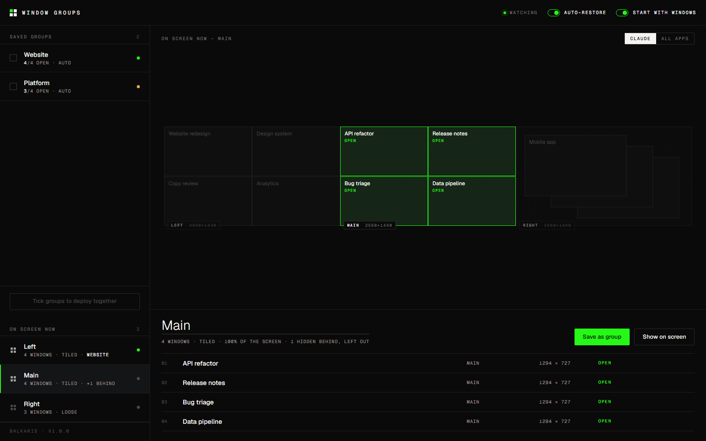

# Brinback

**Save window layouts. Bring them back.**

*Formerly Window Groups. Same app, new name - your groups and settings come along by themselves.*

A small tray app for Windows - and a menu bar app for the Mac - for people who work across many
windows and several screens. It sees how your windows are arranged on each screen, saves a set of
them as a named group - which windows, where, how big, which one is on top - and puts the whole
set back with one click.
When the app that owns them restarts, the windows go back into their groups by themselves.

It knows the [Claude desktop app](https://claude.ai/download): session windows are remembered
by their session, so a group still finds them after a session is renamed. It works with any
other app's windows too.


## What it does

- **Detects layouts - several per screen.** Every layout on every screen shows up under *On
  screen now*, named by where the screen sits ("Top left", "Main", "Far right"). A screen can
  hold more than one: a 3-column snap group in front of a 2x2 that is still snapped behind it is
  two layouts, listed and kept separately. Snapped windows that overlap each other belong to
  different layouts; windows just placed side by side count only where you can see them.
- **Pick what goes in.** Open a found layout and click windows on the map to take them out or
  put them in - including windows hidden behind. The map brings the layout you are looking at
  to the front, even when it is behind others on the real screen. Click the row again, or press
  Esc, to go back to everything.
- **Recognises the snap groups you make in Windows - and keeps them.** Windows 11 groups
  windows you snap with Snap Layouts, then forgets every one of those groups when it restarts.
  Brinback sees which windows are snapped (`IsWindowArranged`, the one signal Windows
  gives), works out which snapped windows form one layout, and once it
  has held still for twenty seconds keeps it as a group named after its screen - so it comes back
  after a reboot. A kept snap group follows its layout as you resize it; rename or edit it and it
  becomes an ordinary group that is left alone; delete it and it is not kept again unless it
  changes. A group you saved yourself is never duplicated. Switch *Keep snap groups* off to only
  ever save by hand.
- **A map you can read with several groups per screen.** Every screen is its own card, to scale
  and where it sits, with a header strip naming the screen and listing every group on it as a
  chip, front to back - *behind* when it is stacked under another. Point at a chip and that group
  lifts to the front of the map; click it to open the group. Selecting a group zooms the map to
  its screens (*All screens* shows the rest).
- **Shows what is grouped and what is just placed.** Every saved group gets a layer on the map -
  a frame that follows its windows exactly - and every window carries an icon: two stacked frames
  for grouped, one dashed frame for not grouped. A window that merely sits between two members
  stays outside the layer.
- **Filter and search.** *All*, *Grouped*, *Not grouped*, and a search box (press `/`). Windows
  that do not match go quiet on the map, and the list under it shows exactly the ones that do -
  with the screen each is on and the group it belongs to. Tick them there or on the map.
- **Saves any set, or adds to one.** Pick windows straight off the map or the list, across as
  many screens as you like, and save them as a new group or *Add to group* an existing one.
- **Deploys as a real Windows snap group.** Windows that together fill a screen are deployed
  through Snap Layouts and Snap Assist - the way you would do it by hand - so Windows itself
  makes them one snap group: listed as a *Group* in the taskbar and in Alt+Tab, square corners,
  shared edges. Any layout Snap Layouts offers on that screen works: halves, quarters, thirds,
  two-thirds, the wide centre. Windows that do not fill a screen go back to their exact place and
  size. Tick several groups and deploy them together, or pick one from the tray menu.
- **Arranges picked windows for you.** Pick some windows and *Arrange* offers layouts for that
  many: side by side or wide and narrow for two, three columns or a half and two stacked for
  three, a 2 x 2 grid, four columns or a half and three stacked for four, a grid beyond that. Pick
  the screen, click a layout: the first window you picked takes the first place. Where Snap
  Layouts offers that shape on the screen they become a real Windows snap group. *Save as group*
  keeps the result.
- **Select all, delete all.** *Select all* in the Saved groups header ticks every group; with
  groups ticked, *Delete* sits next to *Deploy*.
- **Bring to front, minimize.** Bring a group's windows on top of everything without moving
  them - the quick answer to two groups stacked on one screen - or minimize them all.
  Double-click any window on the map to bring just that one to the front.
  Windows drops a snap group once its windows are minimized one by one, so when *Bring to front*
  restores a minimized layout it forms the snap group again, the way Deploy does.
- **Auto-restore.** When a window that belongs to a group opens - after a reboot, or when you
  reopen the app - it is put in its slot. It happens once, when the window appears; moving it
  afterwards is never fought.
- **Shows it on your screens.** *Show on screen* draws a group's slots on the real monitors
  with the window names, for six seconds.
- **Handles what is missing.** A window that is not open is drawn dashed. Click it to put any
  other open window in that place; the slot keeps its position and size.
- **Update positions.** Rearranged a group and like it better? *Update positions*.
- **Keeps itself up to date.** When a newer release is out, *Update available* shows in the
  header and in the tray menu. One click downloads it, checks it and restarts, and an open
  Brinback window just carries on with the new version - see [Updates](#updates).



## Install

Download `Brinback.exe` from [Releases](../../releases) and run it. It lives in the tray
(four tiles, one lit). On first run it adds itself to start with Windows - a shortcut in your
Startup folder, because recent Windows 11 builds skip newly added `Run` registry entries at
sign-in; switch that off in the app or the tray menu. It also lists itself in the Start menu, so typing *Brinback* into
Windows search finds it and opens the window. Windows tucks new tray icons behind the **^**
arrow: drag the four tiles next to the clock to keep them in view.

Windows 10 or 11. The interface opens in a chromeless Microsoft Edge window (Chrome if Edge is
missing), using its own separate profile - it never touches your browser.

Windows may warn about an unrecognised app the first time, because the exe is not code-signed.
If you would rather not run a downloaded binary, build it yourself - it takes seconds and
needs nothing installed:

```
build.cmd
```

That compiles `src/Brinback.cs` with the C# compiler that ships with Windows (.NET
Framework 4) into `dist/Brinback.exe`, with the interface embedded. One file, no
dependencies.

## Updates

Brinback looks for a newer release when it starts and twice a day after that: one plain request
to GitHub's public releases API - no account, no token, nothing about your PC or your windows.
Nothing is downloaded until you click.

When there is one, **Update available** appears next to the wordmark and in the tray menu. Click
it and Brinback:

1. downloads `Brinback.exe` from the release, next to the one that is running;
2. checks it: the size and the SHA-256 GitHub publishes for the file, and that it starts and
   reports the version the release says it is;
3. renames the running exe to `Brinback.exe.old`, puts the new one in its place, and restarts
   in the tray (reopening the window if it was open). The `.old` file is removed on the next start.

If any check fails, nothing is replaced and the app says why. Your groups are not touched by an
update. *Check for updates* in the tray menu looks right away.

**Coming from Window Groups (1.5 or older)?** Those versions cannot update themselves. Download
`Brinback.exe` once and run it: it stops the old copy, carries your groups over from
`%APPDATA%/WindowGroups` (the old folder is left as a backup), and moves *Start with Windows* to
the new name. Then delete `WindowGroups.exe`.

On a Mac the app is built from source, so **Update to ...** in the menu bar menu (or the same
button in the window) runs `git pull` and `mac/build.sh --install` in the folder it was built
from, and reopens. macOS then asks for Accessibility again, because each build is a new signature.

## On a Mac

There is a Mac version too, in [`mac/`](mac/): the same interface and the same groups - save,
deploy, auto-restore, the map, filters, Claude sessions remembered by session - as a menu bar app
for macOS 13 (Ventura) or newer.

**Install it with Claude.** Open Claude Code on the Mac and say:

> Clone https://github.com/Balkaris-ch/brinback and run `mac/build.sh --install`.

That builds the app from source and puts it in `~/Applications` - no download to trust, no
Gatekeeper warning, no admin password. Or do it yourself in Terminal:

```
git clone https://github.com/Balkaris-ch/brinback
cd brinback
mac/build.sh --install
```

It needs Apple's command line tools (`xcode-select --install`, if `swiftc` is missing).

**One step only you can do:** macOS lets no app read or move another app's windows until you allow
it. When asked, switch on *Brinback* under **System Settings > Privacy & Security >
Accessibility**. (After rebuilding, switch it off and on again there - each build is a new
signature.)

What is different on a Mac:

- **No snap groups.** Windows' Snap Layouts form groups the taskbar knows about; macOS keeps
  nothing of the kind, even with its own window tiling. A Mac group is put back at its exact
  positions and sizes, which on a Mac is all there is.
- Lives in the **menu bar** (four tiles, one lit), and opens its window from there.
- *Open at login* instead of *Start with Windows*.
- Groups are kept in `~/Library/Application Support/Brinback/groups.json` (carried over from
  `.../WindowGroups` if you had the app under its old name).
- If the clone on your Mac is still called `window-groups`, it keeps working: GitHub redirects
  the old address.

## Privacy and security

- Everything stays on your PC. Groups are kept in `%APPDATA%/Brinback/groups.json`.
  There is no account, no telemetry, nothing sent anywhere.
- The interface is served on `127.0.0.1` only. Every request must carry the right `Host`
  header (no DNS rebinding) and a random token generated at each start, which only the window
  the tray opens is given. Other programs and web pages cannot drive it.
- Two outside requests, neither carrying anything about you: the interface loads the Geist
  typeface from Google Fonts (with no connection it falls back to Segoe UI), and the app asks
  GitHub's public API for the latest release (see [Updates](#updates)).
- It reads window titles and positions, and the Claude desktop app's `session-popouts.json`
  (session id and title only). It moves windows only when you deploy, or when auto-restore
  puts a newly opened window into its saved place.

## How it works

- **Real snap groups.** Windows has no function an app can call to snap a window or to group
  windows. A window moved to the right coordinates keeps rounded corners and a visible seam, and
  windows snapped one by one with Win+Arrow sit in the right places but are not a group - the
  taskbar does not list them as one. A snap group forms only when windows are snapped through
  Snap Layouts and Snap Assist. So for a layout that fills a screen, Brinback does exactly
  that: Win+Z on the first window, presses the zone of the matching layout, then picks each
  remaining window in Snap Assist. It reads both through UI Automation, so nothing is guessed:
  - the layout is chosen by the shape of its zones - not by its number, which shifts with the
    suggestions Windows puts first, and not by its name, which changes with the display language;
  - the place Snap Assist is filling is read from where its window list sits, and the window is
    picked by invoking its thumbnail, matched on the window's title (the thumbnail's own Close
    button is never touched);
  - Win+Z is only sent while the window being grouped is the one in front, and Escape only while
    the flyout or Snap Assist is.

  Anything that does not work out falls back to the next method and Deploy says so - "not
  grouped on Left, snapped one by one".

- **Snapping one window, not just moving it.** For a single window in a half or a quarter that is
  not part of a full layout, Brinback snaps it the way a person does - Win+Left/Right for a
  half, then Win+Up/Down for a quarter - with safeguards:
  - a snapped window stays "snapped" even after it is moved by code, and Win+Left on a window
    already snapped left throws it onto the next screen, so every window is unsnapped first;
  - it is moved onto the right screen before any key, because snapping acts on the screen the
    window is on;
  - no key is sent unless that exact window is in front at that moment, so a snap key can never
    land on another window;
  - the result is checked with Windows; anything that did not snap is placed exactly instead;
  - Snap Assist is closed afterwards with Escape, but only when it is the window in front, so
    Escape never reaches an app.

  Snapping takes the keyboard for a moment - a second or two for a whole snap group. Deploy does
  it when you click; auto-restore waits until you have not touched the keyboard or mouse for
  three seconds. The interface says for every window whether it deploys as part of a *snap group*,
  *snaps* on its own, or is *placed*.

- **Physical pixels throughout.** The process is per-monitor DPI aware, so a window on a 125%
  screen is saved and restored in the same coordinates. Without this, mixed-scale setups
  restore windows in the wrong place.
- **Placement is done twice.** A window moved onto a screen with a different scale resizes
  itself on arrival; the second call puts the size back.
- **Stacking without stealing focus.** Windows are raised by toggling topmost, which works from
  a background process where `SetForegroundWindow` does not.
- **Matching.** Claude sessions by session id first (their current title), then any window by
  exact title; when two windows share a title, the one already nearest its saved spot wins.
- **Auto-restore waits 2.5 seconds** after a window appears before placing it: the owning app
  positions its own windows on creation, and titles often arrive late.
- **Saved safely.** `groups.json` is written to a temp file and swapped in, so a crash can never
  leave it empty. A file that cannot be read is set aside, never overwritten. If it is locked
  (right after sign-in, a scanner or sync tool can hold it), Brinback waits for it, saves
  nothing meanwhile and says so, instead of starting with an empty list. Once a day the file is
  copied to `backups/`; the last 14 days are kept.

## Uninstall

Switch off *Start with Windows*, exit from the tray menu, delete the exe, delete
`%APPDATA%/Brinback`, and delete `Brinback.lnk` from
`%APPDATA%/Microsoft/Windows/Start Menu/Programs` (and from its `Startup` folder, if it is still
there).

## Building and hacking

| | |
|---|---|
| `src/Brinback.cs` | the whole program: window handling, detection, auto-restore, the local server, tray, overlay |
| `src/ui/index.html` | the interface, embedded into the exe at build time |
| `build.cmd` | builds `dist/Brinback.exe` |
| `tools/make-interop.ps1` | writes the UI Automation interop from the type library inside Windows; `build.cmd` runs it and links the few interfaces it needs into the exe |
| `tools/make-icon.ps1` | draws `assets/app.ico` |
| `tools/demo_server.py` | serves the interface against made-up windows, for screenshots |
| `tools/release.cmd` | builds and checks that the exe, the Mac source and the tag agree on the version |
| `mac/Brinback.swift` | the Mac app: windows through the Accessibility API, the same interface in a WKWebView |
| `mac/build.sh` | builds `Brinback.app`; `--install` puts it in `~/Applications`, `--selftest` tests it |
| `.github/workflows/mac.yml` | builds and self-tests the Mac app on a GitHub-hosted Mac on every change |

## License

MIT - see [LICENSE](LICENSE). Designed in the Balkaris design language.
