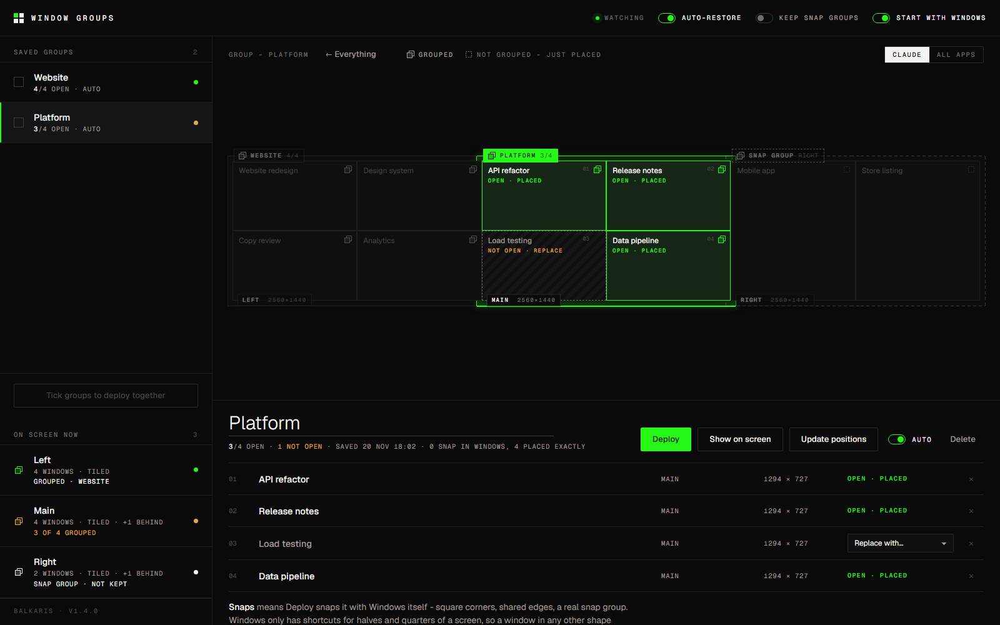

# Window Groups

**Save window layouts. Bring them back.**

A small Windows tray app for people who work across many windows and several screens. It sees
how your windows are arranged on each screen, saves a set of them as a named group - which
windows, where, how big, which one is on top - and puts the whole set back with one click.
When the app that owns them restarts, the windows go back into their groups by themselves.

It knows the [Claude desktop app](https://claude.ai/download): session windows are remembered
by their session, so a group still finds them after a session is renamed. It works with any
other app's windows too.



## What it does

- **Detects layouts - several per screen.** Every layout on every screen shows up under *On
  screen now*, named by where the screen sits ("Top left", "Main", "Far right"). A screen can
  hold more than one: a 3-column snap group in front of a 2x2 that is still snapped behind it is
  two layouts, listed and kept separately. Snapped windows that overlap each other belong to
  different layouts; windows just placed side by side count only where you can see them.
- **Pick what goes in.** Open a found layout and click windows on the map to take them out or
  put them in - including windows hidden behind. The map brings the layout you are looking at
  to the front, even when it is behind others on the real screen. Click the row again, or press
  Esc, to go back to everything.
- **Recognises the snap groups you make in Windows - and keeps them.** Windows 11 groups
  windows you snap with Snap Layouts, then forgets every one of those groups when it restarts.
  Window Groups sees which windows are snapped (`IsWindowArranged`, the one signal Windows
  gives), works out which snapped windows form one layout, and once it
  has held still for twenty seconds keeps it as a group named after its screen - so it comes back
  after a reboot. A kept snap group follows its layout as you resize it; rename or edit it and it
  becomes an ordinary group that is left alone; delete it and it is not kept again unless it
  changes. A group you saved yourself is never duplicated. Switch *Keep snap groups* off to only
  ever save by hand.
- **Shows what is grouped and what is just placed.** Every saved group gets a layer on the map -
  a frame that follows its windows exactly, with the group's name on it - and every window
  carries an icon: two stacked frames for grouped, one dashed frame for not grouped. A window
  that merely sits between two members stays outside the layer. Hover or select a group and its
  layer lights up; *On screen now* says it in words: *Grouped*, *2 of 4 grouped*, *Not grouped*.
- **Saves any set.** Or pick windows straight off the map, across as many screens as you like.
- **Deploys - snapped by Windows itself.** Every window goes back to its saved place and size.
  A window whose place is a half or a quarter of its screen is *snapped* there by Windows, not
  just moved: square corners, shared edges, a real snap group - the same as if you had dragged
  it to the edge yourself. Tick several groups and deploy them together, or pick one from the
  tray menu.
- **Auto-restore.** When a window that belongs to a group opens - after a reboot, or when you
  reopen the app - it is put in its slot. It happens once, when the window appears; moving it
  afterwards is never fought.
- **Shows it on your screens.** *Show on screen* draws a group's slots on the real monitors
  with the window names, for six seconds.
- **Handles what is missing.** A window that is not open is drawn dashed. Click it to put any
  other open window in that place; the slot keeps its position and size.
- **Updates.** Rearranged a group and like it better? *Update positions*.


## Install

Download `WindowGroups.exe` from [Releases](../../releases) and run it. It lives in the tray
(four tiles, one lit). On first run it adds itself to start with Windows; switch that off in
the app or the tray menu.

Windows 10 or 11. The interface opens in a chromeless Microsoft Edge window (Chrome if Edge is
missing), using its own separate profile - it never touches your browser.

Windows may warn about an unrecognised app the first time, because the exe is not code-signed.
If you would rather not run a downloaded binary, build it yourself - it takes seconds and
needs nothing installed:

```
build.cmd
```

That compiles `src/WindowGroups.cs` with the C# compiler that ships with Windows (.NET
Framework 4) into `dist/WindowGroups.exe`, with the interface embedded. One file, no
dependencies.

## Privacy and security

- Everything stays on your PC. Groups are kept in `%APPDATA%/WindowGroups/groups.json`.
  There is no account, no telemetry, nothing sent anywhere.
- The interface is served on `127.0.0.1` only. Every request must carry the right `Host`
  header (no DNS rebinding) and a random token generated at each start, which only the window
  the tray opens is given. Other programs and web pages cannot drive it.
- The one outside request is the interface loading the Geist typeface from Google Fonts. With
  no connection it falls back to Segoe UI.
- It reads window titles and positions, and the Claude desktop app's `session-popouts.json`
  (session id and title only). It moves windows only when you deploy, or when auto-restore
  puts a newly opened window into its saved place.

## How it works

- **Snapping, not just moving.** Windows has no function an app can call to snap a window, and a
  window moved to the right coordinates is not the same thing: it keeps rounded corners and a
  visible seam, and Windows does not treat it as snapped. So Window Groups snaps the way a person
  does - Win+Left/Right for a half, then Win+Up/Down for a quarter - with safeguards:
  - a snapped window stays "snapped" even after it is moved by code, and Win+Left on a window
    already snapped left throws it onto the next screen, so every window is unsnapped first;
  - it is moved onto the right screen before any key, because snapping acts on the screen the
    window is on;
  - no key is sent unless that exact window is in front at that moment, so a snap key can never
    land on another window;
  - the result is checked with Windows; anything that did not snap is placed exactly instead;
  - Snap Assist is closed afterwards with Escape, but only when it is the window in front, so
    Escape never reaches an app.

  Snapping takes the keyboard for about two seconds a window. Deploy does it when you click;
  auto-restore waits until you have not touched the keyboard or mouse for three seconds.
  Windows only has shortcuts for halves and quarters - thirds and other Snap Layouts shapes are
  placed exactly, and the interface says which windows *snap* and which are *placed*.

- **Physical pixels throughout.** The process is per-monitor DPI aware, so a window on a 125%
  screen is saved and restored in the same coordinates. Without this, mixed-scale setups
  restore windows in the wrong place.
- **Placement is done twice.** A window moved onto a screen with a different scale resizes
  itself on arrival; the second call puts the size back.
- **Stacking without stealing focus.** Windows are raised by toggling topmost, which works from
  a background process where `SetForegroundWindow` does not.
- **Matching.** Claude sessions by session id first (their current title), then any window by
  exact title; when two windows share a title, the one already nearest its saved spot wins.
- **Auto-restore waits 2.5 seconds** after a window appears before placing it: the owning app
  positions its own windows on creation, and titles often arrive late.
- **Saved safely.** `groups.json` is written to a temp file and swapped in, so a crash can never
  leave it empty. A file that cannot be read is set aside, never overwritten.

## Uninstall

Exit from the tray menu, switch off *Start with Windows* first (or delete the `Window Groups`
value under `HKCU\Software\Microsoft\Windows\CurrentVersion\Run`), delete the exe, and delete
`%APPDATA%/WindowGroups`.

## Building and hacking

| | |
|---|---|
| `src/WindowGroups.cs` | the whole program: window handling, detection, auto-restore, the local server, tray, overlay |
| `src/ui/index.html` | the interface, embedded into the exe at build time |
| `build.cmd` | builds `dist/WindowGroups.exe` |
| `tools/make-icon.ps1` | draws `assets/app.ico` |
| `tools/demo_server.py` | serves the interface against made-up windows, for screenshots |

## License

MIT - see [LICENSE](LICENSE). Designed in the Balkaris design language.
